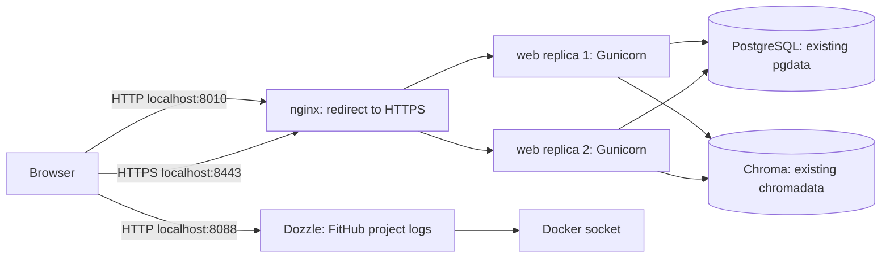

# Local school deployment

The Compose project stays `fithub-school`. Existing PostgreSQL credentials, the shared
Flask `SECRET_KEY`, and the `fithub-school_pgdata` and `fithub-school_chromadata`
volumes are retained. Application schema updates use explicit migrations before web
replacement; see [phase 1 upgrade instructions](./phase1-ui-onboarding.md).



## Update an existing installation

From PowerShell with Docker Desktop running:

```powershell
Set-Location E:\FitHub-School
powershell -NoProfile -ExecutionPolicy Bypass -File .\scripts\update-deployment.ps1
powershell -NoProfile -ExecutionPolicy Bypass -File .\scripts\check-deployment.ps1
```

The updater checks the resolved host ports before changing containers. An existing
FitHub web listener on `WEB_PORT` is allowed because nginx takes its place. Conflicts
with unrelated listeners or reserved ports abort the update and report the conflict;
the script does not stop unrelated services. Select a free port in `.env` and rerun.
It preserves existing `.env` content, appending only missing `HTTPS_PORT=8443` and
`DOZZLE_PORT=8088` settings. `WEB_PORT` remains the HTTP entry port (default 8010),
and `POSTGRES_HOST_PORT` remains unchanged (default 5433). Shell environment overrides
follow normal Docker Compose rules; do not override the existing project name.

The script builds web/nginx, pulls the pinned Dozzle image, waits for dependencies,
runs versioned database migrations and starts services with health checks. It never
runs setup, deletes volumes, resets the database, or generates
replacement application secrets. On a new installation only, use `scripts/setup.ps1`.

Default browser URLs:

| URL | Purpose |
| --- | --- |
| https://localhost:8443/ | FitHub |
| https://localhost:8443/health | Dependency health and serving replica ID |
| http://localhost:8010/ | 308 redirect to HTTPS, preserving path and query |
| http://localhost:8088/ | Project-filtered container logs |

The certificate is self-signed, so a browser initially shows its certificate warning.
It covers `localhost`, `127.0.0.1` and `::1`; host ports are bound to IPv4 loopback.
No system trust store is modified. The validation script temporarily copies the
public certificate and passes it to curl as a trusted CA, checking its hostname and
validity rather than using `-k` for the host HTTPS check.

## Replicas, sessions and DNS

`web` has `deploy.replicas: 2`, so both containers use the same built image, settings
and application code. Neither publishes a host port. `docker compose up -d --wait`
maintains the two configured replicas; no separate `--scale` flag is needed.
Flask signs session/CSRF cookies with the same existing `SECRET_KEY` on both replicas;
accounts, profiles, plans and logs remain in shared PostgreSQL. There is no session
affinity or per-container database. nginx marks the session cookie Secure and passes
the original Host (including port) and HTTPS scheme to Gunicorn. Gunicorn trusts the
proxy's scheme header on this private Docker network.

nginx uses Docker DNS at `127.0.0.11`, a shared upstream `zone`, and
`server web:8000 resolve`. The two DNS addresses form a round-robin upstream. DNS is
refreshed every two seconds, so container recreation and changed IP addresses do not
require an nginx reload. Failed connections and retryable GET responses can use the
other replica. Non-idempotent POST replay is not enabled, avoiding duplicated writes
after a backend has already accepted a request. This gives web-process failover on
one Docker host; the Docker host and single database remain shared dependencies.

The existing `/health` endpoint reports PostgreSQL, Chroma and `socket.gethostname()`.
nginx's `X-FitHub-Upstream` response header identifies the upstream connection for
deployment verification. Quiet sequential `/health` requests alternate replica IDs;
other simultaneous application requests may consume turns in the same round robin.

## Startup, certificates and logs

PostgreSQL uses `pg_isready`. The existing Rust Chroma image has bash but no curl,
wget or Python, so its health check sends a local HTTP heartbeat request using bash.
Both web replicas wait for healthy PostgreSQL and Chroma, and their health checks use
the application's dependency-aware `/health`. nginx waits for both healthy replicas
and checks its HTTPS listener at `/proxy-health`. Dozzle starts after nginx is healthy
and runs its built-in `/dozzle healthcheck`. Health checks report state; Compose
startup dependencies are not a continuous restart controller.

nginx is based on the supported stable `nginx:1.30.6-alpine` image. Its startup script
generates a 365-day self-signed certificate/key only when neither exists, storing
them in the new `fithub-school_tlsdata` volume. Rebuilds/restarts reuse that pair.
A partial pair or expired certificate produces an actionable error instead of
silently replacing TLS material. Existing application secrets are separate.

To explicitly renew an expired local certificate (this changes the certificate the
browser has previously accepted):

```powershell
Set-Location E:\FitHub-School
docker compose run --rm --no-deps --entrypoint openssl nginx req -x509 -nodes -newkey rsa:3072 -sha256 -days 365 -keyout /etc/nginx/certs/localhost.key -out /etc/nginx/certs/localhost.crt -subj /CN=localhost -addext "subjectAltName=DNS:localhost,IP:127.0.0.1,IP:::1"
docker compose up -d --no-deps --force-recreate --wait nginx
```

Dozzle is pinned to `amir20/dozzle:v11.4.0` and filters containers with
`label=com.docker.compose.project=fithub-school`. It reads Docker logs through the
socket, mounted `:ro`; a read-only socket mount does not make the Docker API read-only.
The UI is localhost-only, with actions, shells, MCP, analytics, automatic updates and
the initial setup wizard disabled. Application logs still go to Docker stdout/stderr.
The original PostgreSQL/Chroma images and data volume mappings are unchanged.

## Repeat the checks

`scripts/check-deployment.ps1` checks identical platform image digests and shared
secrets without printing secrets, absence of published web ports, `nginx -t`, the
full PostgreSQL regression suite, host certificate validation/redirect/Dozzle access,
known live replica coverage, authentication/CSRF across replicas, and single-replica
failover. The stopped replica is restarted and awaited until healthy inside `finally`,
including when a probe throws an exception.

After stop/restart/recreation, the proxy gets a bounded 15-second recovery window.
Only transport failures and HTTP 502/503/504 are retried during this window, and
each response/error is recorded. Readiness requires three consecutive healthy
responses and coverage of the expected live IDs. This is followed by eight health
requests that must all succeed; steady-state errors and authentication POST failures
are not retried. Both replicas must be observed in the two-replica phase; only the
survivor is required in the one-replica phase, with the stopped ID explicitly rejected.
Exact A/B/A/B sequencing is not asserted: peer recovery and other traffic can consume
round-robin turns. Cross-replica CSRF is proven using bounded requests rather than
assuming the next request necessarily selects the other replica.

Every run prints a temporary evidence directory. It contains phase JSON reports
with HTTP status, redacted response body, upstream address, timestamps and timings,
plus separate raw stdout/stderr files. Failures capture container states, health,
IP addresses and recent nginx/web/Dozzle logs before restoration. Environment variables,
cookies, request form bodies and CSRF/password input values are excluded. Override
the directory with `-EvidenceDirectory`; use `-RecoverySeconds 0` to reproduce the
original immediate-health-check policy, or a value up to 60 to change the grace window.

It also invokes `scripts/check-dns-recovery.ps1`: recreate one stateless replica,
temporarily reserve its previous IP with a uniquely named probe container, and verify
that nginx discovers its new IP without restarting. The probe is removed and two
healthy replicas restored in `finally`. These checks briefly stop/recreate only this
project's web container. They create temporary random accounts, exercise registration
and login, then remove only those accounts and their empty profiles. Integration tests
use isolated PostgreSQL schemas. Existing users and historical records are retained.

The DNS IP-holder uses a locally inspected image config ID; it does not reuse an
unavailable manifest/index reference from an older running container. Its removal
and replica restoration use nested `finally` blocks so one cleanup failure cannot
skip the other. See [the failover investigation](./validation-proxy-failure.md) for
the reproduced 504 and the checker regression tests.

Run just application regressions if a temporary replica stop is inconvenient:

```powershell
docker compose run --rm --no-deps -T --volume "${PWD}:/srv:ro" --env FITHUB_TEST_DATABASE_URL=connect_timeout=3 web python -m unittest discover -s tests -v
```

For subsequent application-only updates:

```powershell
docker compose up -d --build --no-deps --wait web
```

Keep both data volumes and the TLS volume. `docker compose stop` is sufficient to
stop the project; `docker compose up -d --wait` starts it again.

## Official references verified for this configuration

- [nginx supported stable version](https://nginx.org/en/download.html)
- [nginx upstream round robin, zone, resolver and resolve](https://nginx.org/en/docs/http/ngx_http_upstream_module.html)
- [nginx TLS configuration](https://nginx.org/en/docs/http/ngx_http_ssl_module.html)
- [nginx proxy retries, forwarded headers and cookie flags](https://nginx.org/en/docs/http/ngx_http_proxy_module.html)
- [Official nginx template environment substitution](https://github.com/nginx/docker-nginx/blob/master/entrypoint/20-envsubst-on-templates.sh)
- [Docker embedded DNS](https://docs.docker.com/engine/network/#dns-services)
- [Compose service discovery and IP changes](https://docs.docker.com/compose/how-tos/networking/)
- [Compose startup health dependencies](https://docs.docker.com/compose/how-tos/startup-order/)
- [Compose replicas](https://docs.docker.com/reference/compose-file/deploy/#replicas)
- [Gunicorn forwarded proxy settings](https://gunicorn.org/reference/settings/#forwarded-allow-ips)
- [Dozzle v11.4.0 release](https://github.com/amir20/dozzle/releases/tag/v11.4.0)
- [Dozzle filters](https://dozzle.dev/guide/filters)
- [Dozzle health check](https://dozzle.dev/guide/healthcheck)
- [Dozzle settings](https://dozzle.dev/guide/supported-env-vars)
