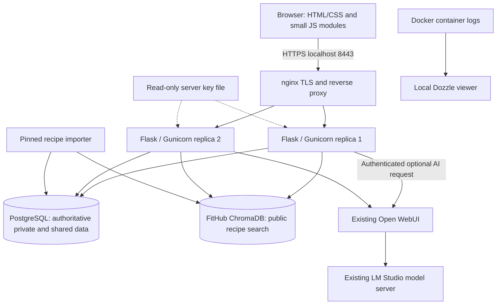
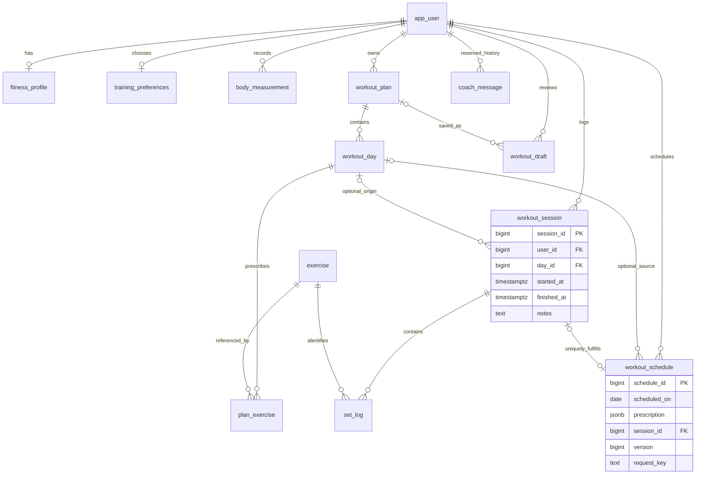
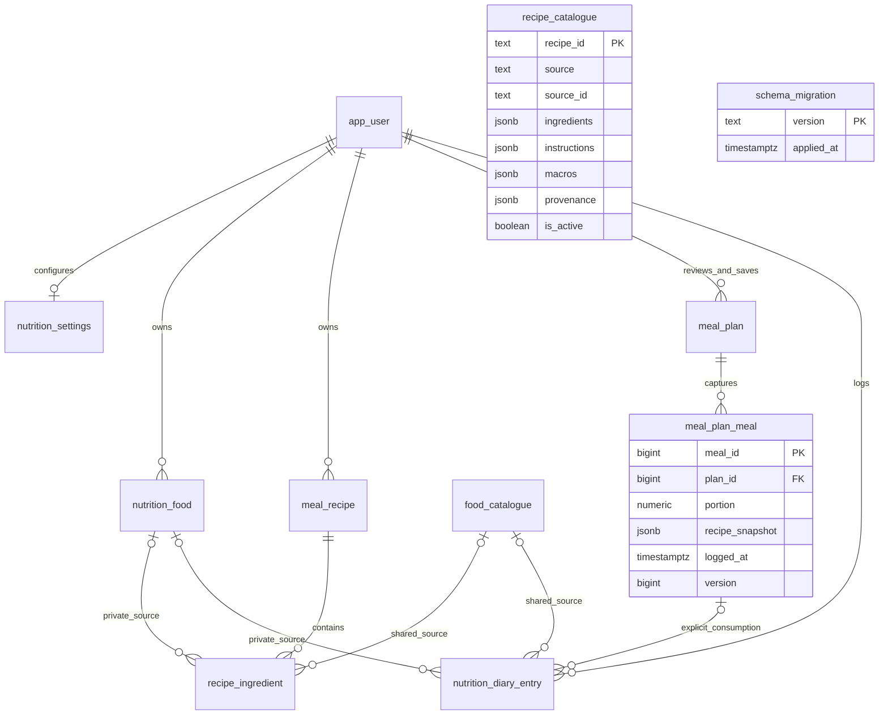

# FitHub — school project

## Purpose and scope

FitHub combines personal workout planning, completed training history and nutrition
planning in one local web application. It helps a user compare sessions, recognize
progress and review a practical plan without making automatic changes to their logs.
The school release uses the implemented Flask/Jinja application, not a design mockup.

Features include registration/onboarding, manual and AI workout drafts, set logging,
last-session references, rest timer, calendar, progress, PRs, weekly recap, bodyweight,
food diary, recipes, target-fitted meal plans, optional names and confirmed meal swaps.
Administrator tools maintain the shared exercise/food catalogues.

## Stack and architecture

Python 3.12 in Docker; Flask 3.1.3, Jinja2 3.1.6, psycopg 3.3.8, httpx 0.28.1 and
Gunicorn 26.2.0 are locked in requirements.lock.txt. The UI uses server-rendered HTML,
CSS and small JavaScript modules. Infrastructure uses PostgreSQL 18, ChromaDB 1.5.5,
nginx 1.30.6 and Dozzle 11.4.0. Open WebUI/LM Studio run separately.

The following diagram follows compose.yaml, the nginx upstream and the actual clients:

| Component | Responsibility |
|---|---|
| PostgreSQL | Accounts, ownership, plans, logs, exact nutrition, snapshots, recipes and migration ledger; source of truth |
| ChromaDB | Search index of shared public recipe descriptions, tags and ingredients; not user history or the nutrition authority |
| Open WebUI | Existing authenticated model/preset interface; FitHub sends bounded structured requests and validates replies |
| LM Studio | Runs the already configured local model; FitHub does not load/download a model |
| nginx | Local HTTPS, HTTP redirect and routing to two identical web replicas |
| Dozzle | Local project-filtered logs; not the user application's authorization layer |

The recipe index uses deterministic **256-dimensional lexical hash vectors**, not
a downloaded semantic embedding model. It can be rebuilt from the pinned public
dataset. PostgreSQL eligibility and stored nutrition always override index output.

## Database design

These diagrams derive from initialization SQL and migrations 001–013. There are 23
application tables. Tables shown without connections are intentionally independent;
recipe references inside JSON snapshots are not foreign keys.

Composite owner keys protect private food/recipe/diary relationships. Workout
session notes contain a versioned prescription snapshot. Meal-plan and diary
snapshots preserve historical values when source recipes, plans or foods change.
Deleting a workout day nulls its history/calendar source reference, retaining the
captured names and completed sets. The coach_message table is reserved legacy
schema; Workout Review is computed on demand and is not stored there.

## Training behavior and validation

Only supported, active exercise IDs with eligible equipment/movements enter a
workout-generation prompt. The server rejects unknown IDs, excluded movements,
timed prescriptions and invalid sets/reps; preview edits are validated again before
explicit saving. Session duration is a simple estimate, not a guarantee.

Starting the same plan day resumes its active session. Calendar starts serialize
with manual starts; a unique session link fulfills one entry once. Other plan days
may have separate active sessions. Scheduled dates are date-only. Completed workouts
and Monday-based recaps use saved timezone handling, falling back to Europe/Sofia.

PRs compare only earlier completed sessions by stable exercise ID. The first result
is a baseline; ties are not improvements. Heaviest load, reps at the same exact load
and unweighted reps are distinct categories. Bodyweight reps do not become zero kg.
Progress keeps an accessible chronological table alongside its chart.

The rest timer uses timestamps and user/session-scoped browser storage, not interval
tick counts. Reloads retain its deadline; completion/logout clears it. Sound is
optional and can require a user gesture. It does not synchronize across devices.

Workout Review sends authorized logged sets, comparable earlier history, prescription
and server-calculated facts/targets. The model selects explanations and at most three
suggestions. Unsupported numbers/IDs are rejected and a server recap is shown instead.
The review never edits a plan or workout log.

## Nutrition fitting and exclusions

Each configured calorie/protein/carbs/fat target is a **hard upper limit**. Missing
targets impose no limit; a configured zero is a real limit. Stored values and Decimal
arithmetic are used for validation. Only display is rounded to whole numbers with
halves away from zero. Unknown values remain unknown, never zero. Positive overages
that round to zero use “Less than 1 … over target”; incomplete totals retain lower-bound wording.

Allergy, unwanted-ingredient and dietary filters run on the server before ranking.
Unknown ingredient/allergen information fails closed under an active allergy.
Candidates missing a nutrient required to check a configured cap are rejected.

The full eligible collection is considered before bounded per-slot selection. Up to
12 recipes enter the model prompt; the server search retains at most 20 candidates
per slot and 128 states. Portions are 0.25–2 servings in quarter-serving steps.
Selection minimizes normalized squared shortfalls, so kcal and grams are comparable.
An optional eligible snack is added only when it strictly improves fit without
exceeding any cap. Recipe ratios or limits may leave unavoidable shortfalls.

Swaps offer up to three alternatives. Similar-calorie tolerance is
±max(50 kcal, 15% of the current scaled meal). Missing comparison values are omitted.
Protein/quicker comparisons require strict improvement. Portions/totals are calculated
by the server; optional AI explanation cannot invent nutrition. Signed/versioned
previews are revalidated against current targets, exclusions and sources on confirmation.
Confirmed swaps replace one planned meal; historical diary entries stay unchanged.

## Privacy, licensing and limitations

Private queries use the signed-in user, not a submitted owner ID. Roles are loaded
from PostgreSQL; mutations require CSRF. Passwords are hashed. Parameterized SQL,
row/advisory locks, unique constraints and explicit confirmations protect critical
writes. Both replicas share a session secret and mount the API key read-only.

Automatic model context omits account identity and credentials; it includes only
the selected authorized profile/preferences/workout facts needed by the feature.
User-entered free text should still avoid private identifiers. User data never
enters the shared recipe index. Local volumes/backups are not application-encrypted;
keep them private. The source repository contains code and fictional fixtures, not
the running database, credentials, private PDFs or model weights.

Public recipes are attributed to UniTools — theunitools.com under **CC BY-SA 4.0**.
The pinned commit, checksums, full license and derivative-data attribution remain
together in [db/data/unitools](../db/data/unitools/ATTRIBUTION.md). The USDA subset
retains FoodData Central provenance. No source recipe photographs are imported.

Of 501 pinned recipes, 122 have complete validated measurements; 100 are selected.
379 rejection reasons and 22 valid-but-unselected recipes are recorded. Only one
selected recipe has complete reviewed allergen metadata; active allergies may leave
no eligible shared meals. There is only one low-fat protein option by the documented
≥20 g protein / ≤10 g fat definition. Expansion did not improve every target fit.

The bounded search is not a global optimizer. Imported mixed-unit recipes have no
verified serving mass, so FitHub does not invent grams or diary entries. Timed set
logging, trainer PDF retrieval, password reset, email verification and login rate
limiting remain outside this release. Local HTTPS is self-signed. The application
is suitable for the local school demonstration, not unrestricted public hosting or
medical/nutritional prescription.
